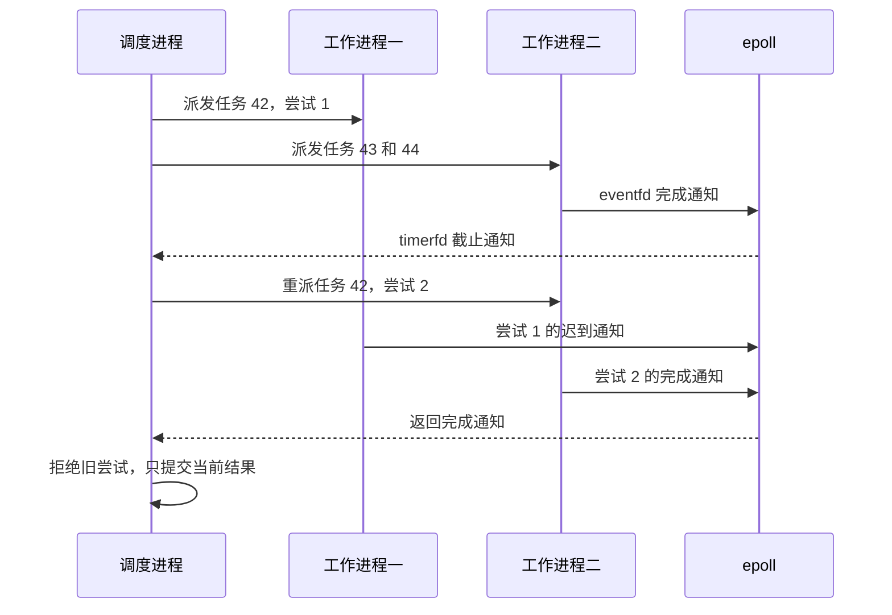

# 使用 timerfd 的任务超时重派

本项目补上了 StarryOS 的单调时钟一次性 `timerfd`，并用一个双工作进程程序展示任务超时后的重派。调度者用同一个 `epoll` 监听 `timerfd` 的截止通知和 `eventfd` 的完成通知，任务与结果通过管道传送。

在已准备好的 WSL 仓库里先构建并验收，再运行演示。

```bash
bash coursework/scripts/accept.sh
bash coursework/scripts/demo.sh deadline_queue
```

超时场景中，任务 42 的第一次尝试停在测试用管道上。另一进程可以继续处理任务 43 和 44。定时器到期后，调度者重派任务 42，并递增该任务的尝试编号。第一次尝试此后交回的结果会被丢弃，只有第二次尝试可以提交。执行顺序可以变化，最终应看到 `TIMEOUT_RECOVERY committed=3 requeued=1 stale=1 PASS`。

第二个场景先确保完成通知和截止通知都可读，再用一次 `epoll_wait` 取出两者。调度规则是同一批就绪事件内先提交有效结果，再处理尚未完成的任务的截止通知。这一场景应看到 `COMPLETION_AND_TIMEOUT committed=1 requeued=0 stale=0 PASS`。



## 内核实现范围

`timerfd_create`、`timerfd_settime` 和 `timerfd_gettime` 支持 `CLOCK_MONOTONIC`、相对及绝对的一次性截止时间、取消、`TFD_NONBLOCK` 和 `TFD_CLOEXEC`。到期后可用 `poll`、`epoll` 或阻塞读取等待，成功读取返回一个 64 位到期计数，值为 1。非阻塞读取在没有到期事件时返回 `EAGAIN`。周期定时、其他时钟和 `TFD_TIMER_CANCEL_ON_SET` 目前不支持。[Linux 接口说明](https://man7.org/linux/man-pages/man2/timerfd_create.2.html)

一个内核任务维护按截止时间排序的队列。重装和关闭会移除旧项，定时任务在唤醒时重新确认该截止时间仍有效。若设置的绝对时间已经到期，系统调用会在返回前通知 `epoll`。首轮客体演示发现，仅等待后台唤醒会使 `poll` 先看到可读状态，但 `epoll` 还收不到该事件。队列用弱引用关联文件描述符，所以定时项不会延长文件的生命周期。定时任务固定在一个 CPU 上，因为现有运行时按 CPU 保存等待计时器。

`timerfd_regression.c` 验证提前重装、绝对截止时间、取消未到期和未读取的事件、阻塞读取以及多个定时描述符。`deadline_queue.c` 验证重派、迟到结果和同批完成与超时。两者都加入 Linux 对照、单核客体验收与多核脚本。演示使用固定任务和最多一次重派，保证的是调度者只接收一个结果。工作进程可能执行多次，因此带外部副作用的任务仍需要幂等处理或单独的提交协议。
