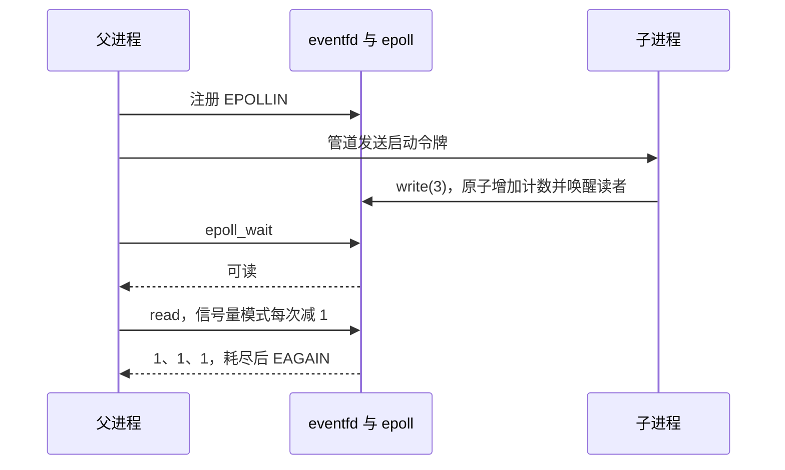

# 事件通知交付与答辩提纲

题目：《StarryOS 事件通知机制的语义修复、性能优化与系统调用安全加固》。以计数通知为主线，getcpu 是独立的系统调用扩展；安全案例说明系统调用边界。演示不携带任务内容，不把 eventfd 当队列，计数 3 表示提交三份同类工作。

## 评分要求—实际成果—验收方法—证据—剩余缺口

| 要求 | 成果 | 验收 | 证据 | 缺口 |
|---|---|---|---|---|
| 功能 30% | fork 子进程写计数、父进程 epoll 等待并消费 | `bash coursework/scripts/demo.sh` | [源码](tests/task_notifier.c)、[新内核日志](logs/task-notifier-initial.log)、[上游日志](logs/task-notifier-upstream.log) | 无任务数据传输；仅单核测试 |
| 深度 25% | 信号量语义、非阻塞路径、缺页重入及写者唤醒 | 对照源码与回归 | [三方面](THREE_ASPECTS.md)、[安全修复](SECURITY_FIXES.md) | 未穷尽 SMP、信号与竞争时序 |
| 工程 20% | 离线构建、单元、静态检查、三项客体回归及哈希 | `bash coursework/scripts/accept.sh` | logs 下按时间生成的 accept 目录 | 全新环境安装未端到端验证；固定 nightly，不声称 stable 兼容 |
| AI 协同 15% | 记录建议、失败和验证 | 读协作记录并自行填写 | [AI 协作](AI_COLLABORATION.md) | 学生自主决策、个人反思需本人填写 |
| 演示答辩 10% | 可观察通知与错误行为，下面有讲稿 | 运行演示并口头解释 | 本文、演示日志 | 正式答辩和个人练习尚未发生 |

## 事件链和不变量

计数器更新是原子的；普通模式取旧值清零，信号量模式减一返回一。可读状态反映计数大于零；一次唤醒可能覆盖多项工作，因此应用必须处理返回的计数并处理 EAGAIN。管道仅建立注册完成后才允许生产的顺序，不证明父进程已经阻塞在 epoll_wait。单次成功不证明所有可能时序不会漏通知。阻塞路径仍经 `block_on(poll_io(...))`；非阻塞先轮询一次，Ready 直接返回（包含 EAGAIN），意外 Pending 回退 block_on。优化避免原来立即完成操作也分配唤醒对象的代价。

## 两个安全反例

1. `mincore` 的输出页未实际分配时，写用户页引发缺页处理，若仍持有地址空间锁会重复获取同锁而 panic。[旧日志](review-20261104/evidence/mincore-guest.log) 保存故障；修复按块查询、释放锁再复制。回归断言惰性页成功，只读输出 EFAULT，溢出和未映射地址受控失败。分块结果不是并发映射修改下的全局原子快照。
2. eventfd 满计数器使写者等待；无效输出地址的读取先消费计数，随后写回失败 EFAULT。旧版漏唤醒，后一次成功读才使写者恢复：[旧日志](review-20261104/evidence/wake-guest.log)。修复在计数发生变化后、用户复制之前唤醒写者。[回归程序](tests/security_regression.c) 分别断言 EFAULT 和子进程成功退出；它使用短暂等待协调阻塞，不能证明所有竞争时序。

其余证据：固定种子、超大 getrandom 和虚假凭据变更见 [审查记录](review-20261104/README.md)。当前随机接口非空请求明确失败，固定 root 且拒绝实际凭据/能力变更，影响依赖这些能力的程序；没有可信随机数或完整凭据模型。

## 五分钟讲稿与追问

**1 分钟：问题。** 上游信号量模式从计数 3 减一却返回旧值 3，违背每次取一个令牌的语义。我们的主线是通知计数如何从生产者到等待者，附带修复立即完成路径的额外开销和两个边界安全问题。

**2 分钟：演示。** 运行 `bash coursework/scripts/demo.sh`。指出子进程提交 3、父进程收到 epoll 可读、连续读取 1/1/1、EAGAIN 与子进程退出 0；普通模式一次读 3。展示上游日志中同一程序读出 3 后退出 1。

**1 分钟：实现与性能。** 画出计数、PollSet、epoll；说明原子取值和非阻塞单次轮询。历史微基准每次启动预热 3000 对，测七轮各 20000 对，两次系统调用及用户循环计时；六次交替启动按每次中位数再取中位数，10.260 到 5.094 微秒约下降 50.35%。这是特定哈希、单核 QEMU TCG 无竞争写读，不是跨进程通知或整机加速。

**1 分钟：安全与边界。** 讲 mincore 持锁写用户页触发缺页重入；讲 eventfd 消费成功但用户复制失败时仍需唤醒写者。说明随机数与凭据明确不支持、nightly 差异和测试范围。

追问：**为什么没有漏事件？** 计数保存尚未消费的通知，即便唤醒合并仍按计数消费；但现有测试不构成对所有并发时序的证明。**为什么不能持锁写用户页？** 用户页可能缺页，处理时再次获取同一地址空间锁导致重入。**50% 测了什么？** 上述无竞争单进程写读耗时，对具体内核和客体哈希有效；没有测跨进程通知延迟。**getcpu 是否保证之后仍在该 CPU？** 否，它只是调用时快照；当前客体单核单节点，节点为 0。

## 必须由学生完成

姓名、学号、成员与真实分工、学生自主选择和个人反思、真实评审与正式答辩均由本人据实填写。老师指定仓库地址尚待提供。讲义书内 141–145 页规定公开指定仓库、个人 AI 协作记录、Markdown 与 Mermaid、核心单元测试及系统自动化。第 143 页的协作模式写明采用 Git 分支和 PR 代码审查，原文明确鼓励的是看板工具。演示视频可选但推荐且不超过五分钟。
