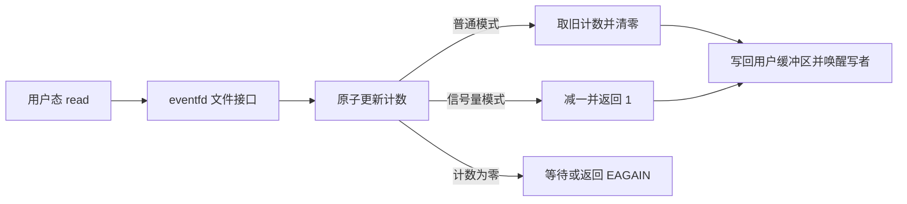

# 设计与选题

## 候选比较

| 候选 | 已读源码的现状 | 范围与验证 | 风险 |
| --- | --- | --- | --- |
| eventfd 信号量读取语义 | `file/event.rs` 已支持普通、非阻塞和信号量模式；读取分支对信号量递减 1，但返回旧计数 | 修正返回值；单元测试计数和并发，客体测试读写、耗尽和普通模式 | 系统验证依赖完整启动；用户缓冲区写失败时已消耗计数的问题不在本次修复范围 |
| copy_file_range 参数检查 | `syscall/fs/io.rs` 实现了复制，明确留有 flags、常规文件及重叠检查 TODO | 增补参数检查并比较 Linux errno/偏移 | 文件对象类型、偏移及部分复制语义复杂，测试范围较大 |
| memfd_create 语义 | `syscall/fs/memfd.rs` 用 `/tmp/memfd-*` 近似，忽略名称及大部分 flags，源码标注 TODO | 真正匿名文件、清理、flags/seal 与并发测试 | 涉及 VFS 生命周期与 ABI，实现和验收成本较高 |

选择 eventfd：与方向 A 的系统调用接口和并发经验相关，问题由代码直接观察，修复范围可控。原始和修改版的 QEMU 客体对照结果见测试报告；验证仅涵盖所列路径。上表和下文中有关写回失败不在修复范围的陈述是历史记录；2026-11-04 后已补上消费后的写者唤醒，见 SECURITY_FIXES.md。

## 结构和行为

最终用户态生产者、epoll 与 eventfd 的时序及并发边界见 [交付说明](DELIVERY.md)；以下为早期单次读取结构，写者唤醒位置以最终源码和安全修复记录为准。

`event_counter::take` 保留上游原子更新及内存序，仅调整返回值并提取纯逻辑以测试；普通模式和空计数路径不变。测试并发读取时总共消费的令牌数。现有实现先消耗计数再写用户缓冲区，写回失败的语义与原子回滚未改变；同样未覆盖 poll/epoll 的全时序、SMP 集成和竞争下的写回失败。此处描述上一轮功能修复；本轮额外的性能测量及限制见 [三方面专题](THREE_ASPECTS.md)。
