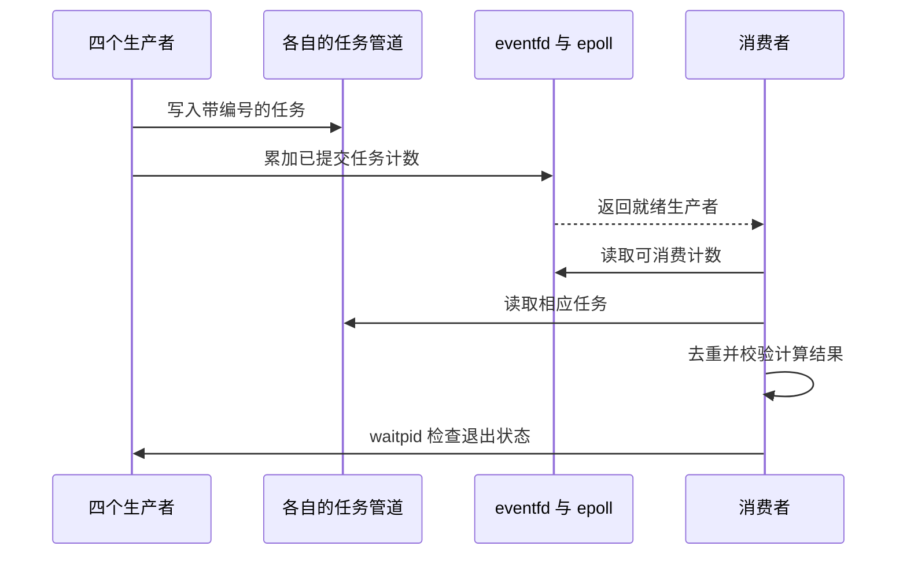

# 多进程任务、通知延迟和 SMP 验证

2026-11-06 按要求核对文档的优先级推进。新增任务程序、通知往返测量、竞争测试和独立重建。完整验收、2 核及 4 核回归均通过。发布目标为用户的公开仓库 ccaixukunnnnn/course-design-b。

## 独立重建与交付

`build-isolated.sh` 从 Git 管理的文件和未忽略的新源码创建快照，使用全新的依赖解包目录和 target 目录，按指定核数构建。已完成 [2 核重建](logs/rebuild-2cpu-D4EPYPod/) 和 [4 核重建](logs/rebuild-4cpu-mKirK677/)。每个目录保存构建日志、源码哈希、工具版本和 config.toml，内核二进制受 Git 忽略规则保护。构建日志明确启用 `axfeat/smp`，配置分别为 2、4 个 CPU。

这项验证复用了本机安装的 nightly、musl GCC、构建工具和下载的 crate 压缩包。全新 Ubuntu 安装、全部依赖重新下载及 stable 工具链仍待验证。首次源码快照遗漏了入口文件通过 include_str 引用的 README，构建失败后补齐，保留失败日志 `rebuild-1cpu-ht7VdB0W`。

```sh
# 在已经准备好 .local 工具及依赖的 WSL 项目目录执行
bash coursework/scripts/build-isolated.sh 2
bash coursework/scripts/build-isolated.sh 4
# 将下面路径换成对应重建命令输出的目录，核数须与 config.toml 一致
bash coursework/scripts/extended-verify.sh coursework/logs/rebuild-2cpu-D4EPYPod/kernel.bin 2
bash coursework/scripts/extended-verify.sh coursework/logs/rebuild-4cpu-mKirK677/kernel.bin 4
```

RISC-V QEMU 平台依赖中的 cpu_num 返回配置的 MAX_CPU_NUM。最初将 4 核内核用于 2 核 QEMU，启动等待超时，见 `extended-2cpu-yPedMSzM`。已分别构建对应内核，验证入口检查相邻 config.toml 并提前拒绝不匹配的核数。错误组合的检查已实际执行，返回非零并提示核数不符。

## 多生产者任务处理

`task_queue.c` 启动四个生产者，每个生产者拥有任务管道和 eventfd，消费者通过 epoll 等待。生产者先提交任务内容，再增加通知计数，消费者按计数从对应管道读取任务并计算平方和。

每个任务带全局唯一编号及载荷，消费者检查编号所属生产者、载荷正确性、重复、总数量和最终平方和。末尾回收全部子进程，检查退出码、管道 EOF 及计数器 EAGAIN。

| 场景 | 结果 |
| --- | --- |
| 普通 eventfd，四生产者各 256 项 | 完成 1024 项，平方和 22500864 |
| 信号量 eventfd，四生产者各 256 项 | 完成 1024 项，平方和 22500864 |
| 第三个生产者提交 128 项后退出 7 | 完成 896 项，平方和 17582912，识别退出码 7 |

失败用例是预设的有序故障注入，生产者在一批任务的通知完成后退出。任意时刻崩溃、任务已入管道而通知尚未写入的恢复机制仍待实现。测试设有超时以避免故障导致无限等待。

```sh
bash coursework/scripts/demo.sh task_queue
```



## 通知往返测量

`notify_bench.c` 用父进程发请求、子进程 epoll 等待并消费、子进程写确认、父进程读确认的链路测量 RTT。每组预热 32 次，采集 256 次，用 CLOCK_MONOTONIC 计时。测量期间缓存样本，结束后打印，以减少输出扰动。测量覆盖普通和信号量模式，每次请求计数为 1 或 16。它不执行任务队列中的平方计算。

脚本连续启动三次独立单核 QEMU，每次使用私有根镜像，保存 3072 个原始样本以及内核、测试程序、源码、根镜像、启动脚本和测量脚本哈希。每次启动分别计算中位数及最近秩 P95/P99，再取三个启动的相应统计量中位数。每次启动中的测试顺序固定，时间波动及顺序效应仍可能影响结果。

| 模式 | 每次请求计数 | RTT 中位数，微秒 | P95，微秒 | P99，微秒 |
| --- | ---: | ---: | ---: | ---: |
| 普通 | 1 | 127.40 | 238.70 | 365.10 |
| 信号量 | 1 | 124.05 | 233.50 | 383.50 |
| 普通 | 16 | 161.30 | 301.10 | 564.10 |
| 信号量 | 16 | 236.40 | 391.10 | 608.80 |

在这次测量中，计数为 16 时普通模式一次读取即可消费整批，信号量模式需要 16 次读取，往返时间相应增加。计数为 1 的小幅差异不足以证明模式优劣。JSON 中 tasks_per_timed_second 表示逻辑计数单位除以累积计时时间，没有包含完整应用工作、启动、预热或结果输出。上述结果是当前内核不同通知模式的比较，历史约 50% 的无竞争写读提速属于另一项实验。

原始日志和完整结果见 [测量目录](logs/notify-perf-e1uh029q/) 与 [results.json](logs/notify-perf-e1uh029q/results.json)。

```sh
python3 coursework/scripts/notify-performance.py
```

## 自动化与多核证据

最终 [单核完整验收](logs/accept-20261106T100251Z-itzNvn/) 为 PASS，包含格式、9 项 Rust 单元测试、Clippy、完整构建、六组客体测试及源码和输入哈希校验。构建仍有 10 条上游 unused 警告。课程 CI 已增加任务队列和竞争用例的 Linux 对照，远端运行待发布后触发。

[2 核验证](logs/extended-2cpu-oD3J4wIe/) 与 [4 核验证](logs/extended-4cpu-lIWF2ohZ/) 均退出 0，覆盖任务队列、epoll 回归以及以下竞争用例。

- 512 轮 ADD/MOD/DEL、文件关闭及描述符复用，检查旧事件不会被当成新注册项返回。
- 四个消费者竞争 4096 个信号量令牌，检查每次读取为 1、总量守恒和全部子进程正常退出。
- 使用无 SA_RESTART 的 SIGUSR1 处理器中断阻塞读取，检查 EINTR，随后重试并成功消费新通知。

多核结果是这些有限负载的回归证据。信号用例使用短暂延迟协调时序，长时间压力、同时修改注册项与等待、进程任意位置崩溃以及全部竞态仍待覆盖。

## 发布与个人工作

用户已选择发布到个人 GitHub，连接账号为 ccaixukunnnnn。用户已创建并授权公开仓库 [course-design-b](https://github.com/ccaixukunnnnn/course-design-b)，用于提交课程源码和建立 PR。姓名、成员分工、真实评审及个人反思仍由本人提供。
