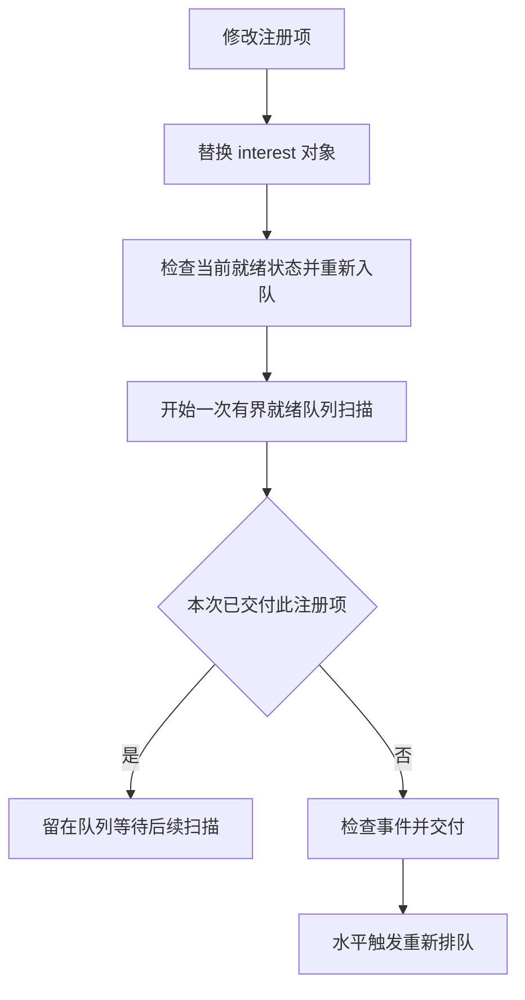

# 课程要求核对与改进记录

核对日期为 2026-11-06。依据《张春元-操作系统实验和课程设计讲义》书内第 141–145 页，对应 PDF 第 147–151 页。后续第 146 页起为组件分析附录。本文记录 AI 对实现和要求的核对，学生的个人决策与反思由本人填写。

## 要求与差距

方向 B 的功能、性能、安全允许任选其一或组合。当前主线为 eventfd 与 epoll 事件通知的兼容性和效率，getcpu 作为辅助扩展。任务书列举的 io_uring、CFS 等是选题示例。

| 评分项 | 已有依据 | 仍影响评价的不足 | 本轮处理或下一步 |
| --- | --- | --- | --- |
| 功能完整性 30% | 双进程 eventfd 通知演示，普通与信号量模式，getcpu | 原测试的 epoll_wait 缓冲区只有一个事件，漏测重复返回和修改注册项后的通知丢失 | 增加 epoll_regression，对照 Linux，修复内核并接入全量验收 |
| 技术深度与创新性 25% | 原子计数、非阻塞快速路径、缺页重入修复 | 现有性能实验为单进程无竞争写读，跨进程延迟、多消费者、公平性证据不足 | 本轮补充就绪队列生命周期分析及轮转回归，后续优先测通知链延迟 |
| 工程规范性 20% | 单元测试、离线验收、格式和 Clippy、带哈希的日志 | 课程单元测试未进入 CI，性能记录缺根镜像哈希，新环境安装未完整验证 | 新增课程 CI 配置及性能输入校验，新环境重建仍待验证 |
| AI 协同与学习 15% | 已保存建议、失败和验证记录 | 学生独立决策、每位成员的反思和贡献仍未填写 | 更新本轮真实操作记录，学生须复核并独立解释方案 |
| 演示与答辩 10% | 双进程演示及五分钟讲稿 | 正式演示、个人练习及问答尚待完成 | 可加入旧内核失败与新内核通过的同程序对照 |

任务书还要求指定公开 Git 仓库、分支与 PR 审查、Markdown 文档、Mermaid 图、核心单元测试和系统自动化。当前 main 指向上游基线，课程改动尚未提交，origin 仍为上游 StarryOS。需要在老师指定仓库完成真实提交与审查。方向 B 演示必选，视频可选但推荐，视频应不超过五分钟。

讲义第 142 页写明 Rust 稳定版，项目实际固定 nightly-2026-02-25。现有验收仅证明该 nightly 环境可构建。此差异需要向老师说明，并确认能否保留上游工具链，或安排独立的稳定版迁移验证。

## 本轮内核修复

### 修改就绪项后丢通知

`Epoll::modify` 创建新的 `Arc<EpollInterest>`，原队列保存的是旧对象的弱引用。旧实现把旧对象的 `in_ready_queue=true` 复制给新对象，却没有把新对象加入队列。后续唤醒会认为新对象已经在队列里，旧弱引用失效后事件无法交付。修复使新对象从未入队状态开始，按当前就绪状态重新入队。

### 同一次等待重复返回

水平触发项交付后立即回到队尾，旧循环会再次取到它，直到填满用户事件数组。单个就绪文件、容量为 8 的事件数组就能复现。修复限定每次扫描的候选数量，并记录本次已返回的注册键，避免并发等待者转动队列时同一注册项再次交付。缓冲区小于就绪项数时保留队列轮转行为。

去重集合只保存已返回的注册项，额外空间为 O(k)，k 不超过本次返回事件数。它引入了哈希和分配开销，目前尚未测量 epoll 等待性能变化。原 eventfd 微基准没有经过 epoll，历史提速比例不能用于评价这次修改。

`epoll_regression.c` 覆盖大缓冲区去重、MOD 更新数据、ONESHOT 禁用及重装、ET 排空后再次触发、删除，以及多个就绪项在小缓冲区下的轮转。相同测试在 Linux 上通过，修改前内核有 7 项断言失败，见 [修改前证据](logs/epoll-before.log)。部分失败是先前注册项状态损坏的连锁结果，按两个根因处理。

最终完整验收通过，证据见 [验收步骤](logs/accept-20261106T090048Z-UbBWyY/steps.tsv) 和 [epoll 客体结果](logs/accept-20261106T090048Z-UbBWyY/qemu-epoll_regression.log)。测试范围与首轮哈希检查失败的原因见 [测试报告](TEST_REPORT.md)。

行为依据为 Linux 手册的注册项修改、用户数据交付及就绪项轮转说明。[epoll_ctl](https://man7.org/linux/man-pages/man2/epoll_ctl.2.html)、[epoll_wait](https://man7.org/linux/man-pages/man2/epoll_wait.2.html)

## 按收益排序的后续工作

1. 完成可复现交付与真实个人记录。用全新 Ubuntu 环境从指定仓库重建，记录依赖版本和下载输入。将本轮回归作为 PR 检查项，解释每个失败的根因与修复。补齐每位成员的贡献、决策和学习反思。这直接对应工程、协同、演示三项合计 45% 的评价内容，实际得分由教师决定。
2. 将通知演示扩展为多生产者任务处理程序。任务经管道传递，eventfd 提供计数唤醒，epoll 调度消费。给任务增加唯一编号，验证无丢失、无重复、正常退出和错误退出。记录任务完成数量，形成可观察的应用成果。
3. 测量端到端通知性能。采用请求与确认握手，测量同一任务从生产到消费确认的往返时间，报告中位数、P95/P99、吞吐、独立启动次数和全部原始样本。将普通模式的批量消费与信号量逐项消费作为自变量，保持 CPU、日志级别和测试程序一致。
4. 扩展竞争验证。优先做多个生产者/消费者、信号中断、文件描述符复用和反复 ADD/MOD/DEL，再在真正启用 SMP 的构建上运行 2/4 核。仅修改 QEMU 的 `-smp` 参数不足以验证内核多核能力。以压力测试和超时日志寻找反例，并解释测试无法穷尽的时序。
5. 如选择安全作为主要创新，再实现完整机制。可信熵源和密码学随机数、真实凭据与访问控制、沙箱都需要独立设计和威胁模型。目前的 ENOSYS 处理消除了虚假成功，安全随机数、凭据模型和 seccomp 过滤仍待实现。

优先完成第 1 项，再选择第 2–4 项中的一个深入验证。当前主线已有明确内核缺陷、修复和可复现反例，继续围绕通知正确性、竞争和延迟开展工作更容易形成连贯答辩。
