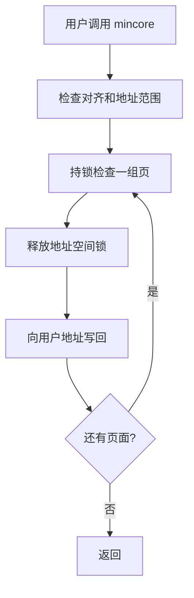

# 2026-11-04 审查问题处理

本次依据 [审查记录](review-20261104/README.md) 处理五项问题。原始失败日志保留；修复后的实际测试见 [测试报告](TEST_REPORT.md)。所有 QEMU 测试使用方向 B 的独立内核和临时镜像。

| 审查项 | 处理 | 保留的限制 |
| --- | --- | --- |
| 固定种子随机数 | 移除固定种子 `SmallRng`；非空 `/dev/random`、`/dev/urandom` 读写明确返回 `ENOSYS` | 当前没有接入可信熵源和密码学安全生成器，**无法提供安全随机数**，依赖随机数的应用可能无法运行。 |
| 超大 `getrandom` | 检查 flags，使用最多 256 字节的栈缓冲分块处理，避免用户长度驱动的大分配；后续出错时保留已成功的字节数 | 当前随机设备不可用，非空请求返回 `ENOSYS`。成功数据和部分失败语义仅以模拟源做单元测试，未在真实熵源上验证。 |
| `mincore` 页错误重入 | 验证对齐、范围和整数溢出，按最多 256 页分块检查；释放地址空间锁后再复制到用户空间 | 结果是分块快照，不能保证并发映射变化下得到单一时刻的全局快照；复杂并发和其他架构未验证。 |
| 凭据修改虚报成功 | 当前固定 root 模型下，仅对不改变 ID 的 `setuid/setgid/setreuid/setresuid/setresgid` 返回成功；不支持的变化、`setgroups/capget/capset` 返回 `ENOSYS` | **没有实现完整凭据或能力模型**；拒绝变化会影响需要切换用户、组或能力的程序。 |
| eventfd 漏唤醒 | 原子消费计数后立即唤醒等待写入者，再尝试向用户地址写回 | 失败读取仍可能消费计数，与本机 Linux 对照一致；其他复杂信号、多核和竞争场景仍未穷尽。 |

## 验证范围

`security-fixes-qemu.sh` 验证随机接口明确失败、极大 `getrandom` 不再 panic、凭据接口拒绝虚假切换、惰性输出页与跨 256 页边界的 `mincore`、零长度与溢出等错误路径，以及 eventfd 写入者在 EFAULT 后被唤醒。另有分块传输和地址范围的主机单元测试，以及原 `getcpu`、seccomp、eventfd 测试回归。

随机数安全的后续工作需要可信硬件或虚拟设备熵源、密码学安全生成器、初始化/耗尽和错误处理策略，以及应用兼容性验证。当前不应将返回错误称为随机数功能已实现，也不能将拒绝无效凭据修改称为完整安全隔离。
