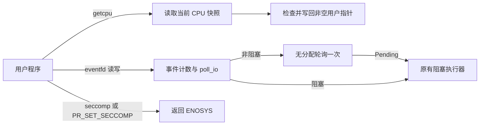

# 功能、性能与安全三方面的改进

## 选题与依据

| 方向 | 修改前源码及实测现状 | 本次范围 | 风险和限制 |
| --- | --- | --- | --- |
| 功能扩展 | 系统调用分发表没有 `getcpu`；修改前 QEMU 返回 `ENOSYS` | 实现 CPU 与节点编号查询，支持可选输出指针和 `EFAULT` | 当前仅验证 RISC-V 单核 QEMU；节点固定为 0，未实现 NUMA 拓扑 |
| 性能优化 | 非阻塞 `eventfd` 也经过 `block_on`，每次分配任务唤醒对象 | 对非阻塞 future 先用静态空唤醒器轮询一次，若意外 Pending 则回退原有阻塞执行器；阻塞路径保持原设计 | 本次只测量无竞争的写读循环；信号、SMP 和不同负载的性能未穷尽 |
| 安全增强 | `seccomp` 和 `prctl(PR_SET_SECCOMP)` 的空实现直接返回成功，修改前 QEMU 均实际返回 0 | 未实现时返回 `ENOSYS`，使调用者能识别沙箱没有启用 | 没有实现 seccomp 过滤器、沙箱或完整权限模型；忽略错误的程序仍可能继续运行 |

选择这三个具体问题，是因为可从实际源码中定位、可以分别做客体验证，且与已有 eventfd 工作能共享测试基础。它们没有实现讲义示例中的 io_uring、USB、CFS 或完整安全隔离。

## 实现结构

`getcpu` 使用 `axhal::percpu::this_cpu_id()` 读取调用时的 CPU；此值只是快照，之后线程可能迁移。平台当前没有 NUMA 拓扑实现，因此报告单一节点 0。两个输出指针均可为空；非空指针通过 `VmMutPtr` 写回，错误地址返回 `EFAULT`。当第一个写回成功而第二个失败时，第一个输出可能已改变。

`eventfd` 仍调用原来的 `poll_io`，因此沿用其准备状态检查和中断检查；非阻塞操作先用 `Waker::noop()` 轮询，避免常见立即完成路径中 `block_on` 创建的 `AxWaker` 分配。Ready 包含成功或 EAGAIN；如果未来 `poll_io` 对该路径返回 `Pending`，则交回 `block_on`。阻塞调用始终使用原执行器。此优化本身不改变写回失败语义；后续安全修复在消费后立即唤醒写者，见 SECURITY_FIXES.md。尚未证明所有信号和多核时序等价。

两个 seccomp 入口原本不安装任何规则却返回成功；现在显式返回 `AxError::Unsupported`，经系统调用转换为 `ENOSYS`。这让正确检查返回值的程序发现功能不可用；它不是新的沙箱、访问控制或完整的安全实现。原有其他身份和权限相关的占位实现并未因此得到修复。

## 测量与验证

详细日志与结果见 [测试报告](TEST_REPORT.md)。宿主为 Intel Core i9-13980HX、WSL2 Linux 6.6.114.1，QEMU 8.2.2 使用 TCG；客体为 RISC-V `virt`、单核、1 GiB、无网络。两版内核使用 nightly-2026-02-25 的 release 构建，静态客体测试程序使用 RISC-V musl GCC 11.2.1 编译。本轮使用同一测试程序，并为每次运行复制同一原始根文件系统，按旧、新、新、旧、旧、新交替启动。每次预热 3,000 组非阻塞 eventfd 写/读，再测 7 轮、每轮 20,000 组；最终取每次启动的 7 轮中位数，再对同版本的 3 次启动取中位数。

| 版本 | 每组写入加读取耗时，中位数的中位数 |
| --- | ---: |
| 本轮修改前（已包含上一轮信号量修复） | 9.937 微秒 |
| 本轮修改后 | 4.974 微秒 |

上述场景下降约 49.94%；包含客体用户循环和两次系统调用，并受 QEMU TCG、WSL、宿主机调度与后台负载影响，不能外推为真实硬件、阻塞 I/O 或整个系统的性能提升。三次启动的全部样本和二进制哈希在 [机器可读结果](logs/three-perf-20261103T143548Z.json) 与相应日志中。独立重建的基线经 QEMU 检查了旧的 getcpu/seccomp 行为和已有 eventfd 修复；生成的内核哈希不同，不能声称二进制逐字节重现。

本次测量期间没有重新构建测试输入，JSON 中的哈希在六次运行之后计算；随后脚本增加了运行前后的哈希一致性检查，供未来复测使用。本次结果不声称已经执行过该后加的检查。

2026-11-04 完成审查问题处理后，使用最终内核和同一静态程序重新进行六次交替测量：[结果 JSON](logs/three-perf-20261103T161622Z.json)。同样以每次启动 7 轮的中位数计算三次启动的中位数，旧版为 10.260 微秒/组，最终版为 5.094 微秒/组，下降约 50.35%。该次运行包含输入二进制前后哈希一致性检查；测试环境与前述相同，仍不能外推到真实硬件、竞争或其他负载。
